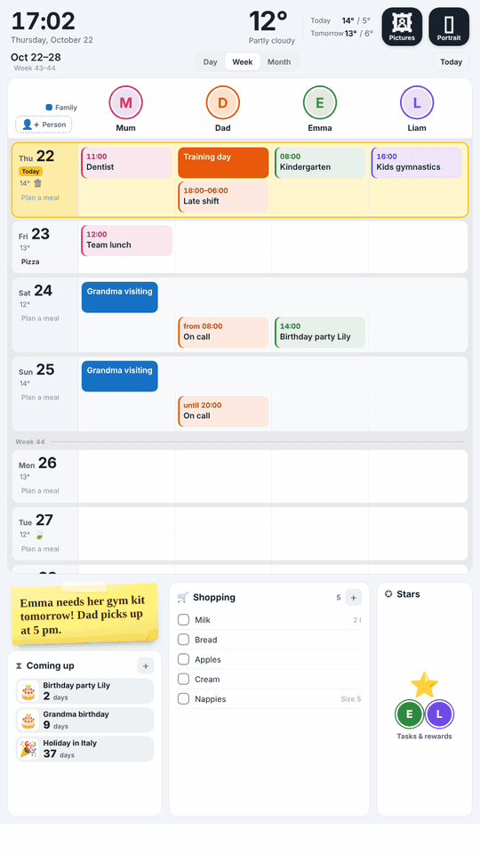
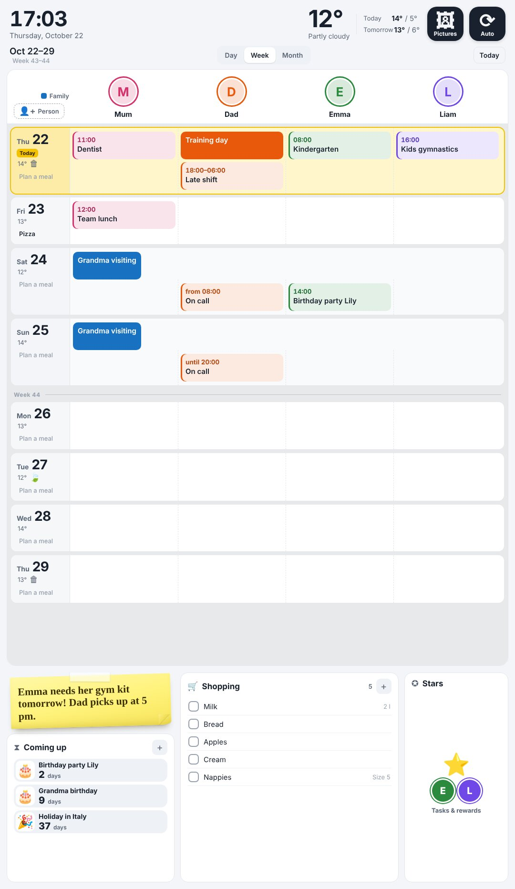
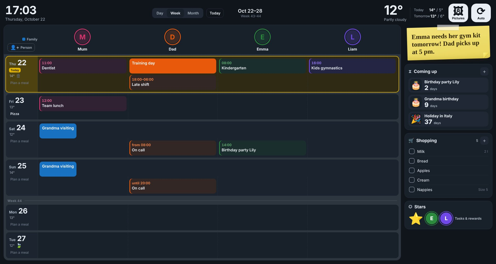

# Family Planner for Home Assistant

🇩🇪 [Deutsche Version](README.de.md)

A touch-friendly week planner for the whole family, made for a wall tablet or touch display. Calendars per person, meal plan, shopping list, chores and a star reward system the kids can use on their own.

[](https://hacs.xyz)
[](https://www.buymeacoffee.com/Waechti)

The planner is free. If your family likes it, I'm happy about a coffee.



| Portrait, light | Landscape, dark |
| --- | --- |
|  |  |

The design follows the light or dark theme of Home Assistant. The interface is available in **English and German** and follows the language of Home Assistant.

## Features

- **Week, day and month view** with one column per person, each in their own colour and with a photo. The week starts today; past days are hidden. Bigger displays automatically show more days.
- **Swipe** left or right to go to the next or previous week (or day, month).
- **Add family members** right on the tablet (name, colour, calendars), e.g. grandma or an au pair.
- **Pictures on events**: kindergarten, swimming, doctor, shopping and about 50 other topics get a matching photo automatically (German and English keywords). Assign your own topics, photos and emojis on the tablet.
- **Meal plan**: one dish per day. Suggestions learn your habits (e.g. pizza on Fridays), favour your favourites (heart) and add variety. "Fill the week" plans all empty days with one tap.
- **Shopping list** (e.g. Bring!): tick off and add items on the tablet.
- **Chores** per person, with stars for kids. They reset every night.
- **Stars & rewards for kids** (tap the "Stars" tile, then pick a child):
  - a big star jar and daily tasks as picture cards (morning / day / evening)
  - big goals like "4× potty → monster truck" or "7 nights in own bed", each with its own stars and reward
  - sticker album, bonus star after 5 days in a row 🔥, celebration with confetti and sound
  - optional: stars only count after a parent confirms (with a 4-digit code)
- **Coming up**: birthdays, your own countdowns and the next school holidays, shown big with pictures for kids.
- **Message board** as a sticky note, **weather** for today and tomorrow, **public holidays**, **waste collection** reminders.
- Night shifts across midnight show up only once ("18:00–06:00").
- Portrait and landscape, light and dark design (optionally dark after sunset).

Events are only displayed; you edit them as usual in your calendar (e.g. Google Calendar).

## Requirements

- Home Assistant 2025.4 or newer
- Calendars in Home Assistant, e.g. Google Calendar via **Remote Calendar** (see below)
- Optional: Bring! (integration "Bring!"), a weather integration (default: `weather.forecast_home`)

## Installation

### Option A: HACS

1. Search for **Familienplaner** in HACS and download it.
2. Not found? Top right ⋮ → **Custom repositories** → add `https://github.com/Waechti/familienplaner`, type **Dashboard**, then search and download.
3. Continue with step 3 below.

### Option B: manually

1. Copy `dist/familienplaner-card.js` to `/config/www/familienplaner/` (create the folder; e.g. with the "Samba share" or "File editor" add-on).
2. Add the card as a resource: **Settings → Dashboards → ⋮ → Resources → Add resource**
   - URL: `/local/familienplaner/familienplaner-card.js?v=1`
   - Type: JavaScript module

   (If "Resources" is missing, turn on **Advanced mode** in your user profile.)

   For an update, replace the file and increase the number after `?v=`.

### Step 3: helpers and automations

1. Save `beispiel/familienplaner_paket.yaml` as `/config/packages/familienplaner.yaml`.
2. Make sure packages are loaded in `configuration.yaml`:
   ```yaml
   homeassistant:
     packages: !include_dir_named packages
   ```
3. Restart Home Assistant.

### Step 4: dashboard

Either use `beispiel/familienplaner_dashboard.yaml` as a YAML dashboard (instructions at the top of the file), or add a view of type **Panel** to an existing dashboard and add a **Manual** card with everything from `type: custom:familienplaner-card` on.

Then adjust names, colours and calendars of the people. A minimal example:

```yaml
type: custom:familienplaner-card
sprache: en
personen:
  - name: Mum
    farbe: "#d6336c"
    foto: input_text.fp_foto_1
    kalender: [Mum]
    aemtli: Ämtli Person 1
  - name: Emma
    farbe: "#2b8a3e"
    foto: input_text.fp_foto_3
    kalender: [Emma]
    aemtli: Ämtli Person 3
    sterne: counter.fp_sterne_3
familie:
  name: Family
  kalender: [Family]
geburtstage: [Birthdays]
```

### Step 5: create the lists

On first start the planner shows **"Create now"** at the top. One tap creates:
- the calendar "Essensplan" (meal plan)
- the lists "Countdowns", "Planer Bilder" and "Ämtli …" (chores)

You need to be logged in as an administrator for this.

## Adding Google Calendar (no Google Cloud project needed)

For each calendar:
1. In Google Calendar **in the browser**: Settings → choose the calendar → "Integrate calendar" → copy the **secret address in iCal format** (contains `/private-`, not `/public/`).
2. In Home Assistant: Settings → Devices & services → Add integration → **Remote Calendar**, use the name you entered in the planner (e.g. "Mum"), paste the address.

The automation in the package fetches new events every 15 minutes. The secret address works like a key to your calendar; don't share it.

## Using it on the tablet

| What | How |
|---|---|
| Add a family member | "+ Person" button at the top left of the week view |
| Edit or remove an added person | long press their photo → "Name & calendar" |
| Show or hide a person | tap their photo |
| Change photo, crop and colour | long press the photo |
| View an event, assign a picture | tap the event → "Assign picture" (or long press) |
| See and change all picture topics | picture button at the top right |
| Plan a meal | tap "Plan a meal" on a day |
| Write on the message board | tap the sticky note |
| Add a countdown | "+" at "Coming up" |
| Show everything coming up full screen | tap the "Coming up" tile |
| Next / previous week | swipe left / right in the calendar |
| Open stars & rewards | tap the "Stars" tile, then pick a child |
| Set tasks, goals, parent code | ⚙️ in the kids view |
| Set or redeem a reward | tap the stars or the reward |
| Mark a favourite meal | tap the heart in the meal window; ✕ on a suggestion = don't suggest again |
| Fix portrait or landscape | button at the top right (Auto / Portrait / Landscape) |

## Card options

The option names are German. Here is what they mean:

| Option | Meaning |
|---|---|
| `personen` | people: list with `name`, `farbe` (colour), `foto` (input_text), `kalender` (calendar names or entity IDs; part of the name is enough), `aemtli` (chore list name), `sterne` (counter, optional), `bilder` (true/false: pictures on events) |
| `familie` | shared family calendar, shown as a band across all columns |
| `geburtstage` | calendars with birthdays |
| `essensplan`, `countdowns`, `bilderliste` | names of the local calendar/lists for meals, countdowns and pictures |
| `bring` | list of to-do entities for shopping; empty = all Bring! lists |
| `wetter`, `abfall`, `notiz` | entities for weather, waste sensor and message board |
| `schulferien` | school holidays: list of `{von, bis, name}` (from, to inclusive, name; YYYY-MM-DD) |
| `schulferien_kalender` | calendar with all-day school holiday events, e.g. your school's iCal |
| `feiertage` | which public holidays to show (see example dashboard); `[]` hides all |
| `eigene_feiertage` | extra days `{datum, name}` (date, name) |
| `personen_hinzufuegen` | `false` hides the "+ Person" button |
| `dunkel` | dark mode: `auto` (like Home Assistant, default), `sonne` (dark between sunset and sunrise), `hell` (light) or `dunkel` (dark) |
| `sprache` | language: `auto` (like Home Assistant, default), `en` or `de` |
| `zuhause_link`, `zuhause_name` | button at the top that opens another dashboard, e.g. `zuhause_link: /dashboard-home` |

### Waste collection

The dates live in the sensor `sensor.familienplaner_abfall` (file `familienplaner_paket.yaml`) as a list `{d: date, t: type}`. Enter the dates of your town there. A push notification the evening before is prepared; add your own `notify.mobile_app_…` action in the automation and enable it.

## Good to know

- **Pictures**: the default photos come from [Unsplash](https://unsplash.com/license) (free to use) and are loaded from the internet when shown. Your own photos and assignments stay in Home Assistant (list "Planer Bilder").
- **Fonts** are loaded from Google Fonts. Without internet, fallback fonts are used.
- **Privacy**: events, photos, meal plan and message board stay in your Home Assistant. The card sends nothing to other servers, apart from loading pictures and fonts.
- Built in Switzerland: public holidays and school holidays default to Swiss settings and can be changed with the options above.

## License

[PolyForm Noncommercial 1.0.0](https://polyformproject.org/licenses/noncommercial/1.0.0): free to use, change and share for non-commercial purposes (e.g. for your own family). Selling it or using it commercially is not allowed. Details in `LICENSE`.

## Support

Found a bug or have an idea? Please open an [issue](https://github.com/Waechti/familienplaner/issues). And if you like: [Buy Me a Coffee](https://www.buymeacoffee.com/Waechti) ☕
