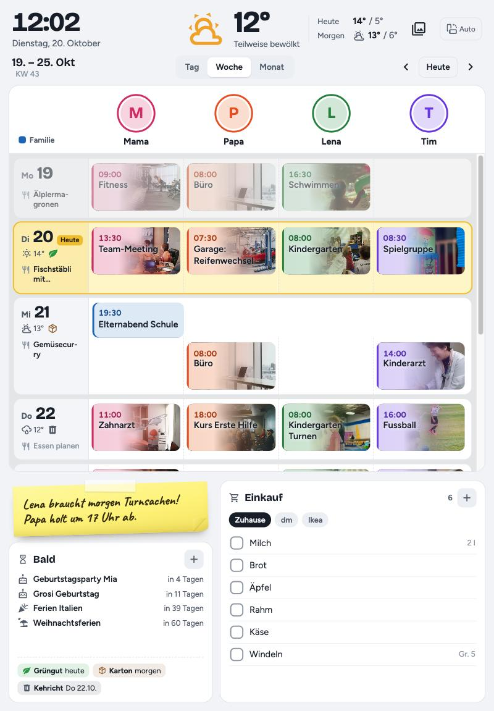
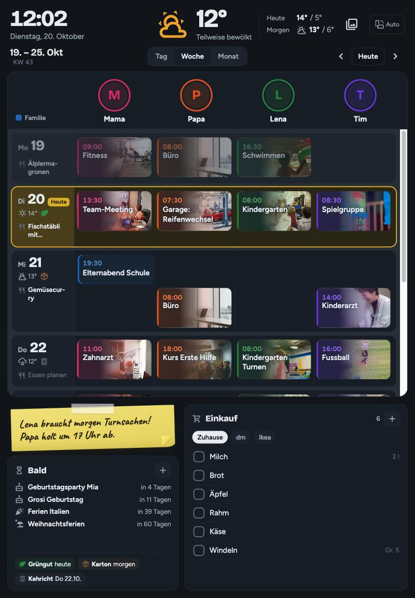
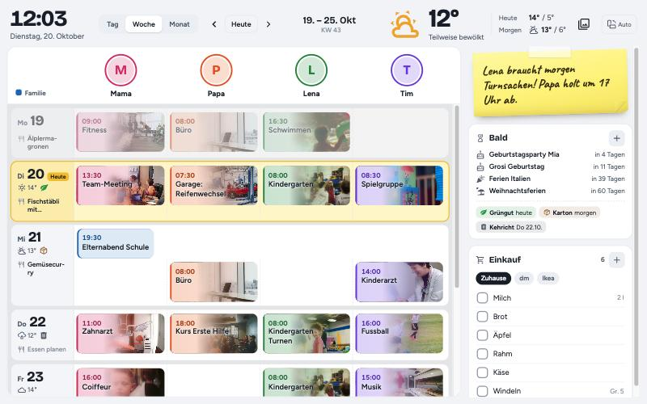
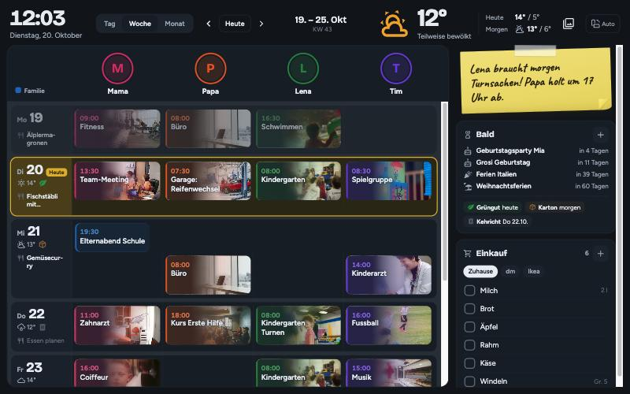
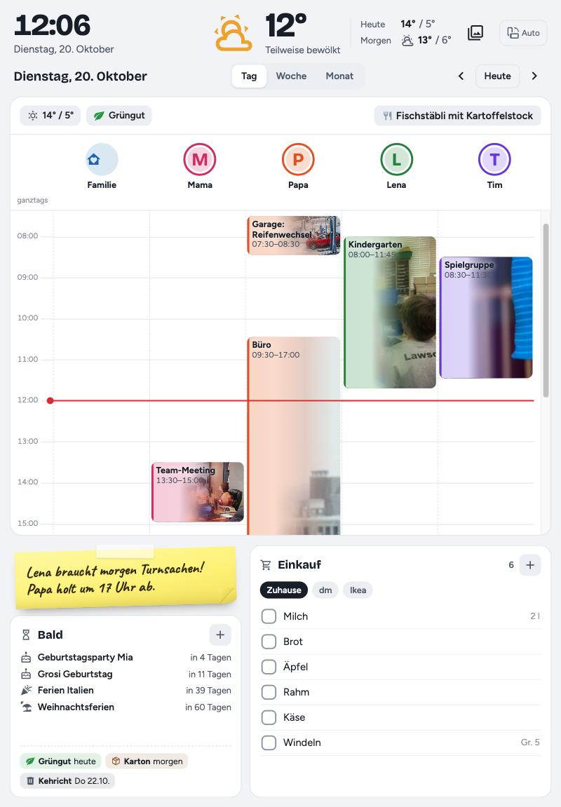
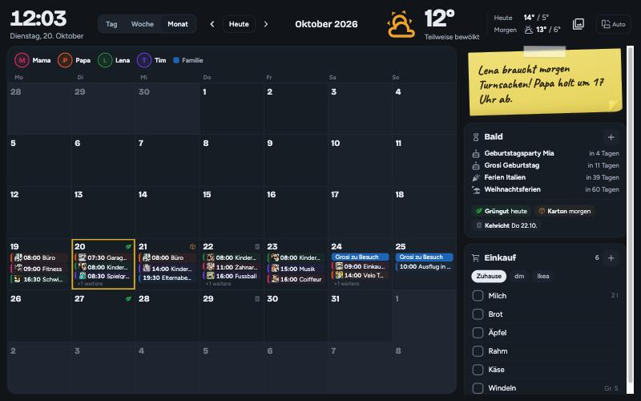

# Familienplaner für Home Assistant

Ein Wochenplaner für die ganze Familie, gemacht für ein Wandtablet oder Touchdisplay im Hochformat.

[](https://www.buymeacoffee.com/Waechti)

Der Familienplaner ist kostenlos. Wenn er euch gefällt, freue ich mich über einen Kaffee.

| Hell | Dunkel |
| --- | --- |
|  |  |

<details>
<summary>Weitere Ansichten: Querformat, Tag, Monat</summary>






</details>

Das Design wechselt automatisch mit dem hellen oder dunklen Thema von Home Assistant.

## Was er kann

- **Woche, Tag und Monat** mit einer Spalte pro Person, jede in ihrer Farbe und mit Foto. Auf grossen Displays zeigt die Woche automatisch mehr Tage.
- **Bilder auf den Terminen**: Kindergarten, Turnen, Arzt, Einkauf und rund 50 weitere Themen bekommen automatisch ein passendes Foto. Eigene Themen, Fotos und Emojis lassen sich am Tablet zuweisen.
- **Essensplan**: pro Tag ein Gericht, mit Vorschlägen aus den letzten Wochen
- **Einkaufsliste** (z. B. Bring!): abhaken und hinzufügen direkt am Tablet
- **Ämtli** pro Person, für Kinder mit Sternen. Jede Nacht werden sie wieder auf offen gesetzt.
- **Bald**: Geburtstage, eigene Countdowns, nächste Schulferien und Abfuhrtermine
- **Pinnwand** als Post-it, **Wetter** für heute und morgen, **Feiertage**
- Nachtdienste über Mitternacht erscheinen nur einmal («18:00–06:00»)
- Hoch- und Querformat, helles und dunkles Design

Termine werden nur angezeigt; bearbeitet werden sie wie gewohnt im Kalender (z. B. Google Kalender).

## Voraussetzungen

- Home Assistant 2025.4 oder neuer
- Kalender in Home Assistant, z. B. Google Kalender über **Remote Calendar** (siehe unten)
- Optional: Bring! (Integration «Bring!»), eine Wetter-Integration (Standard: `weather.forecast_home`)

## Installation

### Variante A: über HACS

1. HACS (ab Home Assistant 2026.11: Marketplace) → oben rechts ⋮ → **Benutzerdefinierte Repositories** → `https://github.com/Waechti/familienplaner` eintragen, Typ **Dashboard**.
2. «Familienplaner» suchen und herunterladen.
3. Weiter mit Schritt 3 unten.

### Variante B: von Hand (ZIP)

1. Die Datei `dist/familienplaner-card.js` nach `/config/www/familienplaner/` kopieren (Ordner anlegen; Zugriff z. B. über das Add-on «Samba share» oder «File editor»).
2. Die Karte als Ressource eintragen: **Einstellungen → Dashboards → ⋮ → Ressourcen → Ressource hinzufügen**
   - URL: `/local/familienplaner/familienplaner-card.js?v=1`
   - Typ: JavaScript-Modul

   (Wird «Ressourcen» nicht angezeigt: im eigenen Benutzerprofil den **Erweiterten Modus** einschalten.)

   Bei einem Update die Datei ersetzen und die Zahl hinter `?v=` erhöhen.

### Schritt 3: Helfer und Automationen

1. `beispiel/familienplaner_paket.yaml` als `/config/packages/familienplaner.yaml` speichern.
2. In `configuration.yaml` prüfen, ob Pakete geladen werden:
   ```yaml
   homeassistant:
     packages: !include_dir_named packages
   ```
3. Home Assistant neu starten.

### Schritt 4: Dashboard

Entweder `beispiel/familienplaner_dashboard.yaml` als eigenes YAML-Dashboard verwenden (Anleitung steht oben in der Datei), oder in einem bestehenden Dashboard eine neue Ansicht vom Typ **Panel** anlegen und eine Karte **Manuell** mit dem Inhalt ab `type: custom:familienplaner-card` einfügen.

Danach Namen, Farben und Kalender der Personen anpassen.

### Schritt 5: Listen anlegen

Beim ersten Öffnen zeigt der Planer oben **«Jetzt anlegen»**. Ein Tipp legt automatisch an:
- den Kalender «Essensplan»
- die Listen «Countdowns», «Planer Bilder» und «Ämtli …»

Dafür muss man als Administrator angemeldet sein.

## Google Kalender einbinden (ohne Google-Cloud-Projekt)

Für jeden Kalender:
1. In Google Kalender **im Browser**: Einstellungen → Kalender wählen → «Kalender integrieren» → **Privatadresse im iCal-Format** kopieren (enthält `/private-`, nicht `/public/`).
2. In Home Assistant: Einstellungen → Geräte & Dienste → Integration hinzufügen → **Remote Calendar**, Name wie im Planer eingetragen (z. B. «Mama»), Adresse einfügen.

Die Automation im Paket holt alle 15 Minuten neue Termine. Die Privatadresse ist wie ein Schlüssel zum Kalender und sollte nicht weitergegeben werden.

## Bedienung am Tablet

| Was | Wie |
|---|---|
| Person aus- oder einblenden | Foto antippen |
| Foto, Ausschnitt und Farbe ändern | lange auf das Foto drücken (Foto verschieben und vergrössern) |
| Termin ansehen, Bild zuweisen | Termin antippen → «Bild zuweisen» (oder lange drücken) |
| Alle Bild-Themen ansehen und ändern | Knopf mit dem Bildsymbol oben rechts |
| Essen eintragen | beim Tag auf «Essen planen» tippen |
| Pinnwand schreiben | Post-it antippen |
| Countdown hinzufügen | «+» bei «Bald» |
| Eintrag bei «Bald» ausblenden | Eintrag antippen |
| Hoch- oder Querformat fest einstellen | Knopf oben rechts (Auto / Hoch / Quer) |

## Einstellungen der Karte

| Option | Bedeutung |
|---|---|
| `personen` | Liste mit `name`, `farbe`, `foto` (input_text), `kalender` (Namen oder Entity-IDs; ein Teil des Namens genügt), `aemtli` (Listenname), `sterne` (Counter, optional), `bilder` (true/false) |
| `familie` | gemeinsamer Kalender, erscheint als Band über alle Spalten |
| `geburtstage` | Kalender mit Geburtstagen |
| `essensplan`, `countdowns`, `bilderliste` | Namen der lokalen Kalender/Listen |
| `bring` | Liste von To-do-Entitäten; leer = alle Bring!-Listen |
| `wetter`, `abfall`, `notiz` | Entitäten für Wetter, Abfallsensor und Pinnwand |
| `schulferien` | Liste `{von, bis, name}` (JJJJ-MM-TT, «bis» inklusive) |
| `schulferien_kalender` | Kalender mit ganztägigen Ferienterminen, z. B. ein iCal der Schule |
| `feiertage` | Auswahl der Feiertage (siehe Beispiel-Dashboard); `[]` blendet alle aus |
| `eigene_feiertage` | zusätzliche Tage `{datum, name}` |
| `zuhause_link`, `zuhause_name` | Knopf oben, der zu einem anderen Dashboard wechselt, z. B. `zuhause_link: /dashboard-zuhause` (Pfad aus der Adresszeile). Ohne `zuhause_link` kein Knopf |

### Abfall

Die Termine stehen im Sensor `sensor.familienplaner_abfall` (Datei `familienplaner_paket.yaml`) als Liste `{d: Datum, t: Art}`. Die Daten der eigenen Gemeinde dort eintragen. Eine Push-Nachricht am Vorabend ist vorbereitet; dafür in der Automation die eigene `notify.mobile_app_…`-Aktion eintragen und sie aktivieren.

## Gut zu wissen

- **Bilder**: Die Standardfotos stammen von [Unsplash](https://unsplash.com/license) (frei verwendbar) und werden beim Anzeigen aus dem Internet geladen. Eigene Fotos und Zuordnungen bleiben in Home Assistant (Liste «Planer Bilder»).
- **Schriften** werden von Google Fonts geladen. Ohne Internet erscheinen Ersatzschriften.
- **Daten**: Termine, Fotos, Essensplan und Pinnwand bleiben in deinem Home Assistant. Die Karte sendet nichts an fremde Server, ausser den Abruf von Bildern und Schriften.

## Lizenz

[PolyForm Noncommercial 1.0.0](https://polyformproject.org/licenses/noncommercial/1.0.0): kostenlos nutzen, anpassen und weitergeben für nicht-kommerzielle Zwecke (z. B. für die eigene Familie). Verkaufen oder kommerziell nutzen ist nicht erlaubt. Details in `LICENSE`.

## Unterstützen

Fehler gefunden oder eine Idee? Gerne als [Issue](https://github.com/Waechti/familienplaner/issues) melden. Und wer mag: [Buy Me a Coffee](https://www.buymeacoffee.com/Waechti) ☕
